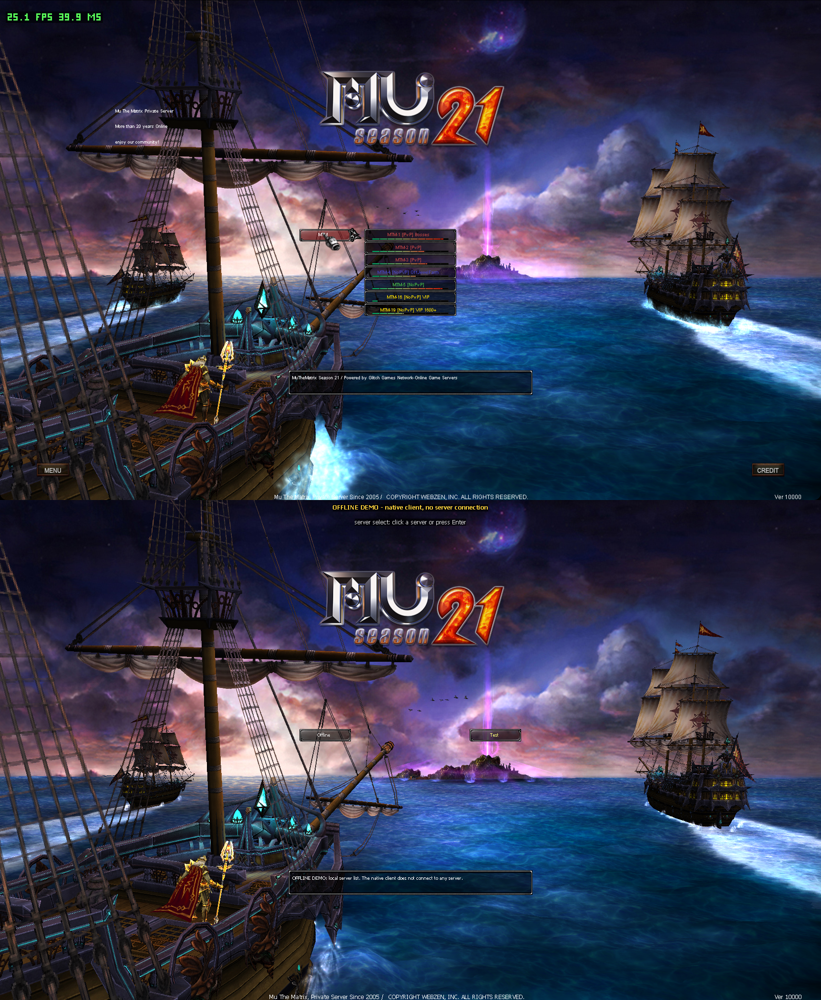
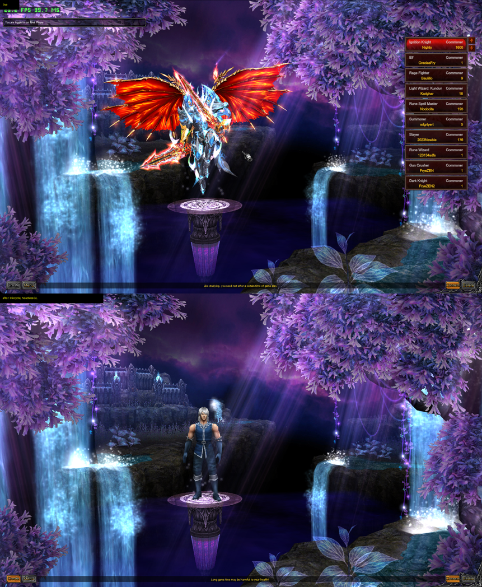
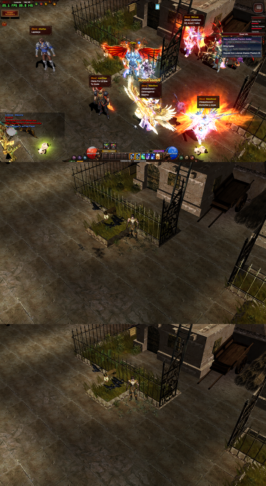
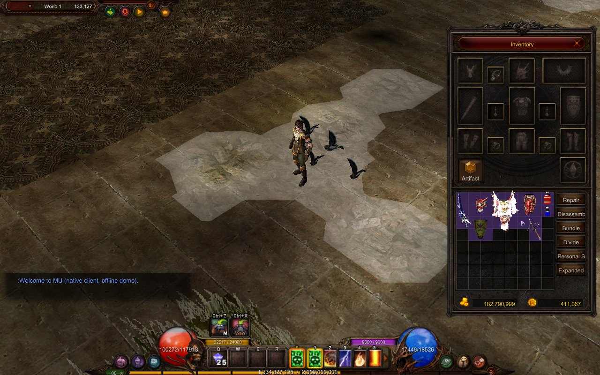
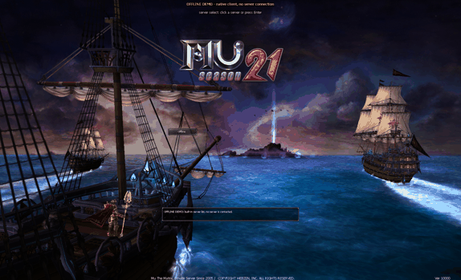
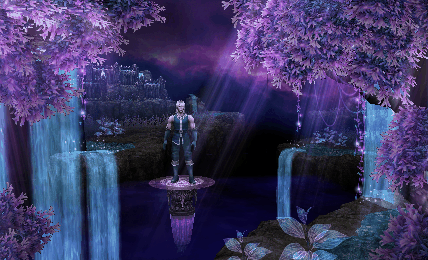

# Mu The Matrix on macOS

Two tracks are moving this exact Mu The Matrix client onto the Mac. **The original Windows game is playable on Apple Silicon through Wine**, with a Mac app, installer and performance patches. **The native macOS port is an offline work in progress**, with reconstructed rendering and gameplay components running without Wine.

## Play on Mac with Wine

The Wine version supports the original launcher, server selection, login and live gameplay. `Mu The Matrix.app` installs the Windows compatibility layer, .NET and the game, then opens the launcher on subsequent launches. The default route uses free Wine; CrossOver remains an alternative.

Start with the [player guide](mac-play/PLAYER-GUIDE.md). You need an Apple Silicon Mac, macOS 13 or later, Rosetta 2, about 12 GB of free space and your game account. Testing so far covers one Mac on macOS 27.0.1. Get the packaged app from the server team's distribution, or build it using the [Mac app instructions](mac-play/bundle/README.md). Runtime setup and the legacy CrossOver route are documented in [mac-play](mac-play/README.md).

### Optimizations for the game's hard 25 FPS cap

The client runs game logic at 25 Hz and caps rendering at 25 FPS, giving each frame a 40 ms budget. Our optimization work aims to hold that cap everywhere while preserving the client's behavior and appearance.

Multiple rounds of profiling and patches now reach the cap in tested towns, hunting scenes and the default-view Tormenta boss fight. The work includes:

- Native implementations of hot CPU routines, including model transforms and mesh submission, with comparisons against the client's results.
- OpenGL batching, terrain sorting, deferred state changes and off-screen culling to reduce draw work.
- Faster character shadows and terrain decals, plus mesh append batching for crowded fights.
- Precise frame-pacing waits and thread-priority fixes to avoid missed 40 ms deadlines.
- Faster JPEG decoding and CRC-32 calculations, checked against the original results, to reduce map-loading work.
- A fast x87 translation path and a newer free Wine runtime, tested together with the Mac app.

| Recorded scene or configuration | Result |
|---|---|
| Lorencia, standing, v7.6 | 25.00 FPS, about 12 ms of frame work |
| Twisted Karutan, zoomed out, v7.4 at the recorded load | 24.99–25.00 FPS, about 36–37 ms of work |
| Tormenta boss fight, default view, v7.5 | About 25 FPS, 33–35 ms of work, down from 45–50 ms |
| Free Wine CX26 + fast x87, app installation rehearsal | 25.0 FPS, 35.3 ms of work in the reference scene |

These are recorded results on the test Mac, not a guarantee for every camera, scene or Mac. The zoomed-out boss fight still measured roughly 20–23 FPS in the v7.6 sessions, and map transitions still cause loading stalls. The default downloadable free runtime documented in the player guide is the older CX24 build, which reached about 15 FPS in the busy reference scene. The tested faster CX26 runtime still needs distribution; the guide explains using a supplied runtime file. See the [performance report](docs/research/mac-performance.md) and [free-runtime report](docs/research/mac-free-runtime.md) for measurements, verification and remaining limits.

## Native macOS port progress

The native work rebuilds this client's behavior in editable source. It already has interactive world and character tools and an offline client shell. It is not yet a complete live-server game client.

| Area | Progress |
|---|---|
| Worlds | Terrain, water and lava, world objects, camera, lighting and culling; recovered local object placements for selected worlds |
| Characters and movement | Skeleton animation, pose building, CPU skinning, class and gear assembly, glow passes, click-to-move and long-distance path following |
| World activity | Monsters and NPCs, reconstructed combat and skill components, particles, sprites, joints, shadows, ambient sound and footsteps; server-driven placements and behavior use labelled demos |
| Login and character select | Reconstructed 3D scenes, object lifecycles, waterfalls and selection effects in the offline shell |
| Interface | Original GFx movies through a patched Ruffle runtime, HUD, inventory item models, tooltips, chat, overhead names and HP boxes; recovered text tables |
| Validation | Bounded comparisons against captured client instructions, installed-file corpus checks and selected live-state comparisons, documented per module |

Build and run instructions are in [native/README.md](native/README.md). The [status](docs/status.md), [handoff](docs/handoff.md) and [roadmap](docs/roadmap.md) track recovered behavior and remaining work. Live networking and end-to-end gameplay acceptance remain open; a convincing scene does not establish a finished port.

### Live client and native port comparisons

All screenshots and GIFs below already existed. They are reused unchanged. "Live" means the original Windows client running through Wine on the Mac. "Native" means the offline macOS reconstruction. Characters, gear, interface data and animation phases differ between captures. These images show visual progress, not matched-frame equivalence.

**Login and server selection.** Live above, native OpenGL below. The native scene reconstructs the ships, ocean, sky, camera and lighting; its server buttons use offline demo data. [Scene recovery](docs/research/client-login-scene.md), [lighting comparison](docs/research/client-model-light.md).



**Character selection.** Live above, native below. The native scene has the world's objects, animated waterfalls, particles and selection light. The plain demo character does not reproduce the live character's equipment or character-list panel. [Character-select recovery](docs/research/client-character-select.md).



**Lorencia lighting.** Live at the top, native before the lighting correction in the middle, native after at the bottom. The native scene recovers the environment's geometry and lighting; the live players, shops and HUD are absent from this milestone capture. [Lighting evidence](docs/research/client-model-light.md).



**Native interface progress.** A later native capture shows the original HUD and inventory movies with item models over the world. Values and inventory contents are demo inputs. [GFx integration](docs/research/native-gfx3.md), [overhead names](docs/research/client-overhead-text.md).



### Existing native animation GIFs

These earlier milestone recordings show movement in the reconstructed scenes. The login GIF predates the lighting correction shown above; the GIFs are not live-server recordings or FPS benchmarks.

| Native login scene | Native character-select scene |
|---|---|
|  |  |

[Media provenance and capture limitations](docs/media/README.md).

## Start here

| You want to… | Read |
|---|---|
| Continue with an agent | [AGENTS.md](AGENTS.md), then [handoff](docs/handoff.md) |
| See what actually works | [Current status](docs/status.md) |
| Build and run checks | [Setup](docs/setup.md) |
| Choose a contribution | [Roadmap](docs/roadmap.md) and [contributing](CONTRIBUTING.md) |
| Understand the code boundaries | [Architecture](docs/architecture.md) |
| Recover executable code | [Code recovery](docs/code-recovery.md), [Mac-only runtime](runtime-linux/README.md), [Windows helper](windows-capture/README.md) |
| Work on assets | [Images](docs/asset-recovery.md), [models](docs/model-recovery.md), [primary sources](model-recovery/SOURCES.md) |

## Recovery foundations

These earlier structural and component-level results underpin the native work above. Their bounded checks do not establish complete gameplay equivalence.

| Component | Verified result | Remaining gap |
|---|---|---|
| Startup decompressor | Portable C builds; four original blocks match independent decoding byte for byte | Recovered 41,984,000-byte region is still protector material |
| Native inspection | REA/Ghidra decompile a restored client arithmetic routine from a verified prefix | Full function map, calling conventions and behavior still need recovery |
| Client memory operation | Authored 64-byte copy/clear match captured x86 in 393 / 768 cases | Original type/callers unknown; clear feature state supplied explicitly |
| Record arithmetic | Cofactor/inverse source matches captured x86 in 1,680 / 1,050 controlled cases | Types/callers and native FP state unknown; unsupported domains remain |
| Client model decoder | Authored v12 C decoder matches captured x86 in 4,048 synthetic cases and all 180 installed v12 payloads | Complete loader, original types and hierarchy semantics remain open |
| Code navigation | First 64 KiB mapped with explicit candidate origins and REA comparison | Heuristics are incomplete; symbols/types and outside references unresolved |
| Mac-only runtime | QEMU x86 Linux/Wine restores a repeatable 23,572,480-byte client-code mapping | No demonstrated login/gameplay; compatibility-environment limits remain |
| Images | 19,703 / 19,707 wrapper candidates decode; selected PNG exports match pixels | Three terrain images rejected; one candidate is actually mesh text |
| BMD models | 12,663 / 12,754 files parse; versions 10, 12, 14 and 15 supported | 17 rejected; 74 other/table files unsupported |
| Effect descriptions | 370 JSON files parse; all 92 distinct texture references resolve locally | Original engine interpretation of their fields remains open |
| Windows capture helper | Builds as a Windows x64 console program; hash and own-memory smoke tests pass under Wine | Actual game capture on Windows has not been validated |

The latest original-file scan and all binary evidence stay local. [The evidence index](docs/evidence-index.json) preserves artifact identities, coverage, and relative locations without bundling game material.

## Build the recovery modules

Python 3.9+, Clang/Clang++ and Crypto++ are required. The portable build targets macOS and Linux. Pillow supports image-reader tests; Capstone checks bounded control-flow maps; Crypto++ supplies the eight v14 block ciphers.

```sh
# macOS; on Debian/Ubuntu install libcrypto++-dev instead
brew install cryptopp
python3 -m venv tools/python
./tools/python/bin/python -m pip install -r tools/requirements-portable.txt
make test PYTHON=./tools/python/bin/python
```

The default suite uses authored fixtures and public LEA test vectors. Checks requiring the original installation or private evidence are explicitly skipped when those inputs are absent. To run those checks, follow [private integration setup](docs/setup.md#private-integration-checks).

```sh
# Optional Windows helper cross-build with MinGW-w64
make windows
```

## Project map

```text
asset-recovery/        Image wrappers and editable text-mesh readers
model-recovery/        BMD geometry, bones, animation and encrypted envelopes
reconstructed/boot/   Tested C startup decompressor
reconstructed/client-memory/  Restored client behavior with instruction comparison
reconstructed/record-math/  Controlled cofactor/inverse reconstruction
windows-capture/      Read-only Windows executable-region capture source
reconstructed/model-codec/  Client-linked BMD decoder with exact alias behavior
mac-play/             Playable Wine setup, Mac app, optimizations and player guide
native/               Native rendering, interactive tools and offline client shell
runtime-linux/        Mac-only x86/Wine procedure and scoped text capture
scripts/              PE inventory, REA collection, loader recovery and emulation
model-recovery/fixtures/  Public cryptographic vectors, no game data
docs/                 Findings, architecture, roadmap and agent handoff
.github/              CI and contribution templates
```

`input/`, `evidence/`, `runtime/`, `vendor/` and recovered asset outputs are local-only and ignored. Supply your own matching installation; no game executable, asset pack, process dump or recovered game payload is distributed here.

## Direction

The Wine track keeps the original client playable on macOS while the native track reconstructs and validates its behavior. Recovery uses restored client code, instruction comparisons and selected live-client observations. The native port must still pass the [gameplay acceptance gates](docs/roadmap.md) before it replaces the Wine version. An older MU client is not a substitute for this exact-version target.

## Target identity

- Format: PE32, x86 Windows GUI, 32,229,376 bytes.
- Embedded version label: `1.20.87.0`, not independently verified release provenance.
- `main.exe` SHA-256: `3cf91f3c203d305a771b04d00b271871f7ce1c6779b22e30fbae8c4f35b5527a`.
- Entry VA: `0x0e646058`; image base: `0x00400000`.

## License

Original code and documentation in this repository are MIT licensed; see [LICENSE](LICENSE). The license covers this project's implementations, not the supplied game, its assets, decompiled output, or external tools. Source references and their distinct licenses are listed in [third-party notices](THIRD_PARTY_NOTICES.md).
