<h1 align="center">Mu The Matrix Native</h1>

<p align="center">
  <b>A real arm64 macOS client for Mu The Matrix, rebuilt from evidence.</b><br>
  No Wine, no Rosetta: the client's own behavior, reconstructed in C and checked against its original instructions.
</p>

<p align="center">
  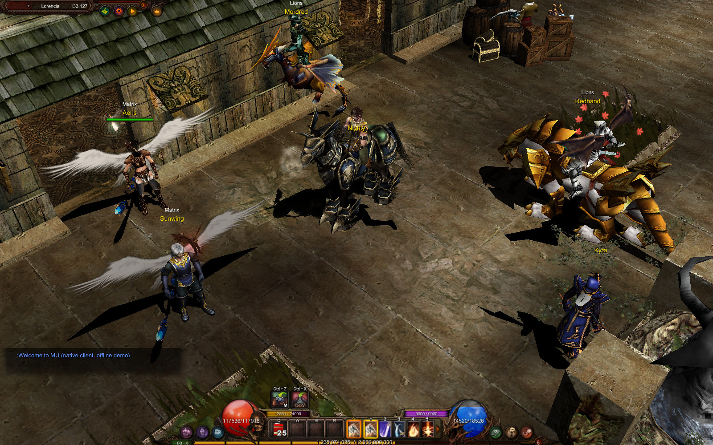
</p>

<p align="center">
  <a href="#what-works-today">What works</a> ·
  <a href="#how-it-is-built-evidence-first">Method</a> ·
  <a href="#progress">Progress</a> ·
  <a href="#architecture">Architecture</a> ·
  <a href="#build-and-run">Build and run</a> ·
  <a href="#scope-and-legal">Scope and legal</a> ·
  <a href="https://github.com/fryezero/mu-the-matrix-mac">Play on Mac today</a>
</p>

> [!NOTE]
> **Want to play now?** The native client is an **offline preview**: it does not connect to live servers yet. To play
> Mu The Matrix on a Mac today, use [**mu-the-matrix-mac**](https://github.com/fryezero/mu-the-matrix-mac), the
> one-download app that runs the original Windows client at 25 FPS.

---

## The goal

Mu The Matrix is a MU Online private server whose Windows client (`main.exe`, version 1.20.87.0) runs on Macs
only through Wine. This project rebuilds that exact client as a **native Apple-silicon program**: the same
worlds, characters, interface, rules and timing, compiled for arm64 and drawn with OpenGL on macOS. It is not a
different MU version, a generic engine or a remake: every routine is matched against the client it replaces.

Today the native client plays offline. It goes from the login scene and server list through character select and
creation into the world, where you walk, fight, talk to NPCs, shop, follow quests and use skills, with the
original interface movies. You can open the map and travel between worlds, ride mounts, mix items at the Chaos
Goblin, trade with and mail other (demo) players, gain experience and spend stat points. The network layer that
would connect it to the live servers is the main missing piece ([what is still missing](#what-is-still-missing)).

## How it is built: evidence first

Each piece of the client is reconstructed as **authored C** and then **verified against the client's own machine
code**:

1. **Find the routine.** Static analysis of the unpacked client (REA, Ghidra, Capstone) locates the code, its data
   and its callers. Addresses, digests and observations go into a research note.
2. **Write it in C.** A readable reimplementation goes into `reconstructed/<module>/`, with the original addresses in
   its comments.
3. **Run both and compare.** A validator in `scripts/validate_*.py` executes the client's **original x86
   instructions** in the [Unicorn](https://www.unicorn-engine.org) CPU emulator, feeds both the same inputs
   (synthetic cases, every installed data file, deliberate mutations) and requires identical outputs, down to GL
   call streams, written tables and floating-point results.
4. **Check against the running game.** Where the client's state matters, read-only tools in
   [`live-readers/`](live-readers/README.md) snapshot the running original client (in Wine, on the same Mac) for
   comparison.
5. **Only then** wire it into the native client in `native/`.

Some of the recorded comparisons:

| Area | Verified result |
|---|---|
| BMD model decoder | 4,048 synthetic cases and all 180 installed v12 payloads match the client's decoder |
| Bone tracks, pose builder, skinning | 11,962 installed models; 47,833 pose-builder and 3.8 million vertex-transform comparisons |
| Mesh draw | Every GL call, cache and colour equal in 207 synthetic, 500 mutated and 2,713 installed-model cases (6.9 million GL records) |
| Path finding | 7,945 + 3,100 comparisons on synthetic grids and all 82 installed attribute maps, 0 mismatches; 16 planted mistakes caught |
| Item attributes | 604,981 comparisons over all 4,881 items and 300 synthetic records, 0 mismatches |
| Effects | 1,870 cases, 109,774 frames and 595,838 particle records against the client's effect code |
| Item mixing, personal store, repair | 98,506 comparisons, 0 mismatches; 23 planted mistakes caught |
| Party, trade, messenger, mail | 36,700 comparisons over two rounds, 0 mismatches |

Every claim is labelled as verified, statically read or demo. The details live in
[research notes](docs/research/), [status](docs/status.md) and [roadmap](docs/roadmap.md).

## What works today

All screenshots below are the **native macOS client** (offline; demo accounts, characters and servers), except
where marked as the original client.

### Title, login and server select

The client's login world (ships, sea, sky, island beam) with the server list and login overlay drawn by the
reconstructed 2D layer, in the **Native Preview** app. The Preview was rebuilt from current main on October 28,
fixing a stale data lookup and missing hero MP/AG that refused selected-skill casts. Its offline smoke runs
walk, cast, pick up a drop and travel Lorencia → Noria → Devias → Lorencia; the network guard records zero
connection attempts
([refresh checks](docs/handoffs/APP-REFRESH-001.md)).

<p align="center">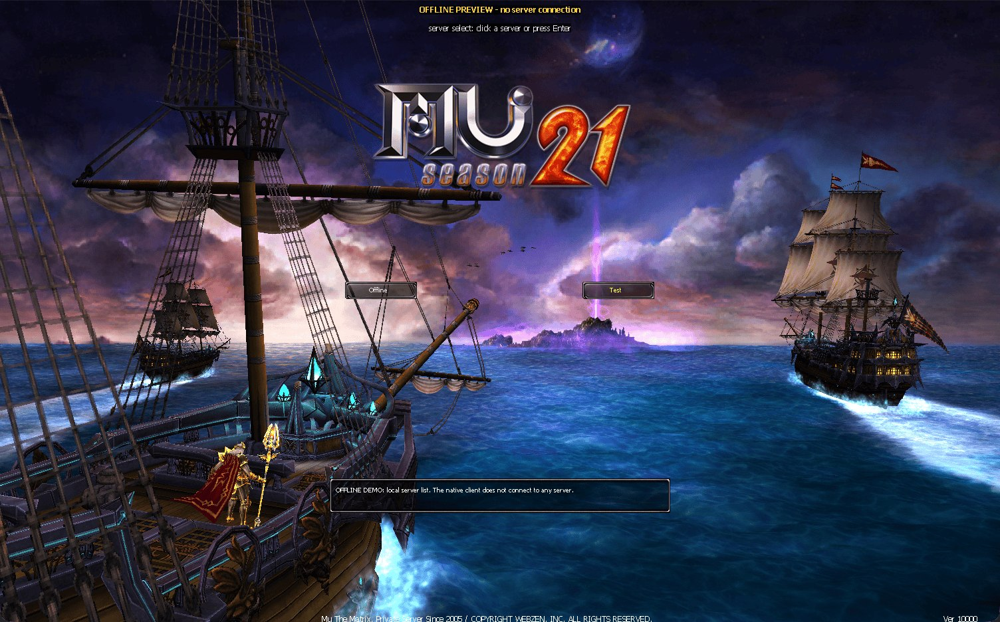</p>

<details>
<summary>Compare with the original client</summary>
<p align="center">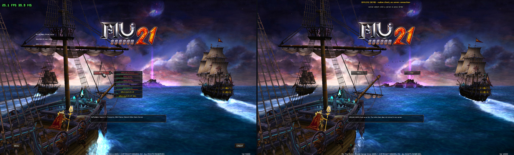<br>
<sub>Left: the original client in Wine. Right: native. A milestone snapshot, not a pixel-matched test.</sub></p>
</details>

### Character select and creation

The character-select world with its waterfalls and selection light, the GFx character list, and the creation panel
with all 16 classes, name rules and the menu. The standalone tool and the full client now share one
character-select runtime with explicit draw passes; the extraction preserved the existing renders.
Account-backed character lists and create/delete requests remain separate work
([runtime checks](docs/handoffs/CHARSEL-RT-001.md)).

<p align="center">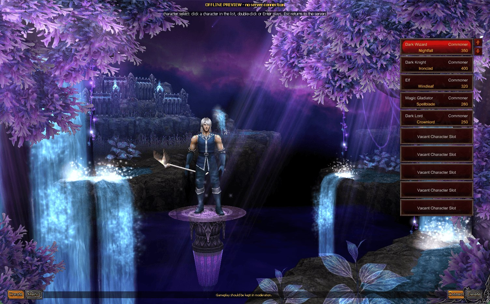</p>

| | |
|---|---|
| 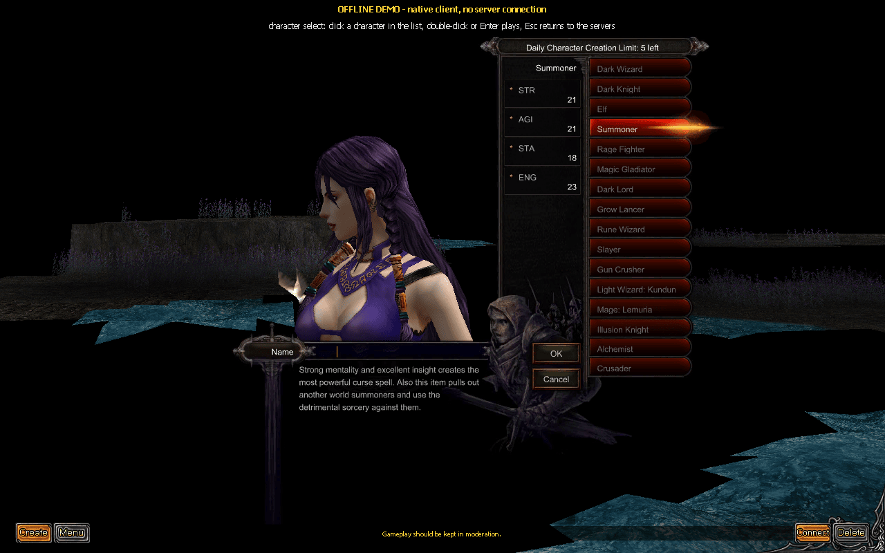 | 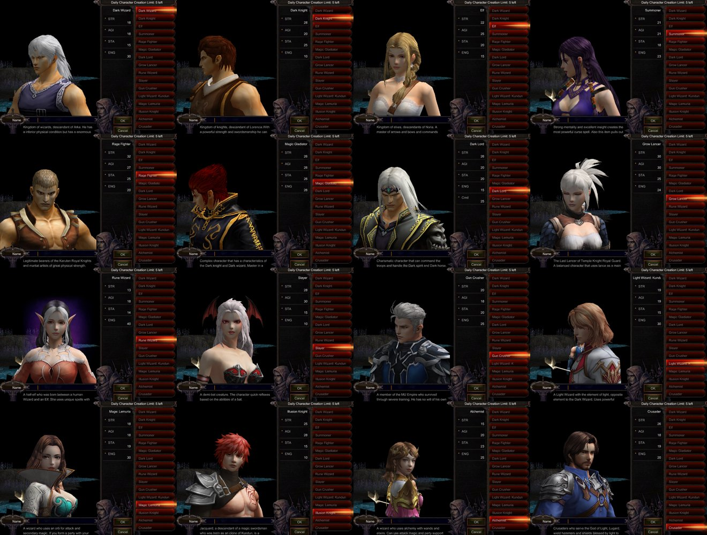 |
| Character creation: class list, stats and description | All 16 classes |

### The world: terrain, lighting, objects, water, weather

Terrain with the client's lighting, water and lava, world objects through the client's object lifecycle, ambient
creatures (fish, birds, leaves), weather, blob shadows and frustum culling. The October 27 and 28 work adds:

| World | Now rendered natively |
|---|---|
| Icarus | Persistent cloud cover, sky lights, swirls, dragons and emitter ribbons |
| Kanturu and Karutan | Flame particles |
| Noria, Elbeland, Raklion and Karutan | Deferred object draws after characters and environment |
| Devias, Tarkan, Elbeland and Raklion | Doors, object movement and code-created placements; Elbeland boids/clouds and Raklion snow |
| Tarkan and Raklion | Additive screen haze |
| Noria and warp sites | Portal placement and nested warp effects |
| Santa Village, Vulcanus, Duel Arena and world 82 | Primary object create, move and visual methods |
| Loren Market and Uruk Mountain | Primary object methods; Market lamps follow the current pose |
| Raklion and Karutan | Primary methods completed; Karutan lamp/waterfall and Raklion/Market particle lifecycles |
| Lost Tower, Tarkan and Icarus | Built-in sprites and push bodies, lamps and plumes, Icarus bone flares |

Coverage is **33/144 verified primary world-handler methods across 11/48 classes**; 111 remain. That
inventory counts class methods, not complete maps; other world paths have separate checks. In the saved
fourteen-view tour, the built-in Icarus visuals reduce its full-draw image error from **26.897 to 23.154**.
Eleven of the tour's original images are unavailable, so the other new world work claims no image score.
Raklion's event timer is implemented, but starts inactive without authoritative event state. Exact animation
phases and fresh live comparisons remain open ([world evidence](docs/research/client-world-fidelity.md),
[coverage inventory](docs/research/client-worlds-j.md), [built-in visuals](docs/handoffs/RENDER-WORLDS-K.md)).

A native temporal check now replays fourteen scripted views in thirteen maps and compares 21 full-draw samples
per view (animation, objects, particles, lights, sky, RNG) against fixed thresholds, as a regression gate. Its
original-client half, capturing the same paths in the live client with matched clocks, remains open
([temporal checks](docs/handoffs/RENDER-TIME-001.md)).

<p align="center">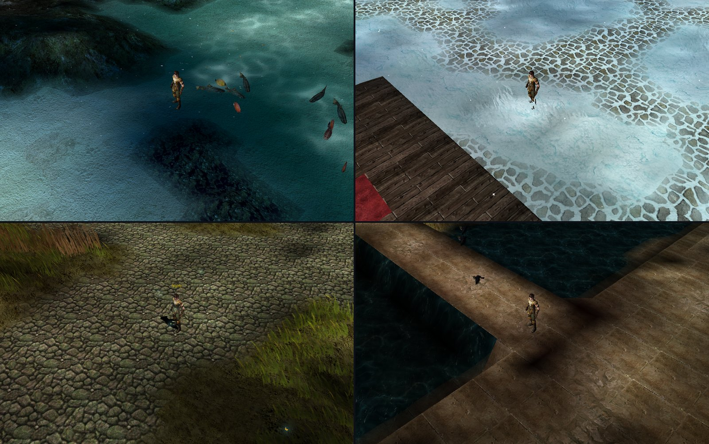</p>

<details>
<summary>How the lighting was matched to the original</summary>
<p align="center"><br>
<sub>Top: the original client. Middle: native before the lighting correction. Bottom: native after
(<a href="docs/research/client-model-light.md">evidence</a>).</sub></p>
</details>

#### Checked against the original, map by map

A fidelity tour puts the original client and the native one side by side in 13 worlds, at the same tile and camera,
and scores the difference. The camera and the main terrain light already matched everywhere; the tour found what
did not, and the fixes went back through the same Unicorn checks: Icarus no longer draws a ground it should not
have, Dungeon's torches and Kanturu's braziers light the scene, and Atlans's crystals pulse. The mean pixel
difference dropped from 6.9 to 2.0 in Dungeon and from 9.9 to 3.7 in Kanturu.

<p align="center">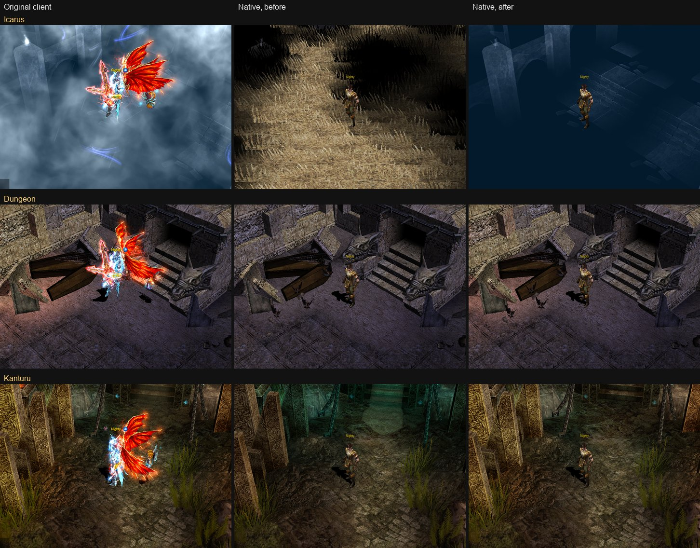<br>
<sub>Left: the original client (live, in Wine). Middle and right: native before and after the fixes. The live hero
wears its own gear; the native one is the demo character. These October 22 images predate the cloud, dragon,
flame and haze work above. They record that earlier comparison
(<a href="docs/research/client-world-fidelity.md">evidence and remaining gaps</a>).</sub></p>

### Input and the local test session

Keyboard, mouse and scripted actions now enter one world input router. It handles held keys, focus loss and
UTF-8 text/preedit, so typing does not trigger combat. `--input-script FILE` shares the same frame-based key,
mouse, wheel and text format across `mu-client`, `mu-shell`, `mu-world` and `mu-walk`. Available bindings and
panels still waiting for an implementation are listed in the [input coverage table](docs/research/client-input.md).

The session now owns these domains, with replies supplied by a local loopback test server:

| Feed | Session behavior |
|---|---|
| Hero and quests | Hero updates, quest progress, tracker and window state |
| Nearby players | Creation, movement, death, store state, equipment and helper presentation |
| Monsters and NPCs | Shared viewport records, fixture placement and movement |
| Combat | Action, damage and death replies drive the rendered results |
| Skills | Learned skills, saved hotkeys, Master ranks and fourth-tree state in headless and GFx builds |
| Ground items | Drops, labels, pick-up removal and despawn; no inventory insertion or zen credit is claimed |
| Minimap markers | NPC/portal markers and detector dots, replayed when the map movie reopens |
| Party | Party membership, supplied member bars and invitations in the existing party HUD |

Mutable session and runtime state has explicit owners, with sequential and fresh-process parity checks
([state ownership](docs/handoffs/SESSION-GLOBALS-001.md)).

**Eleven fixture scenarios pass**, with 86 inbound plaintext frames and no unbound or undecodable frames in
those scenarios. Two unrecovered intents and nine unsent requests remain explicit. Encrypted quest/skill/combat,
pick-up and party requests stay unsent; fixtures supply their replies. This is offline session coverage, not
online play ([items](docs/handoffs/SESSION-ITEMS-001a.md), [map](docs/handoffs/SESSION-MAP-001a.md),
[party](docs/handoffs/SESSION-SOCIAL-001a.md)).

### Maps and travel

Tab opens the client's map overlay (its own `hudMap` movie) with the NPC and gate markers; M opens the Move window
with its level and cost list. Choosing a destination, or walking into a gate, loads the next world, as in the
original. The demo server answers the warp. The map's NPC/portal markers and detector dots now come from session
records; travel, warp requests and respawn keep their earlier offline path.

<p align="center">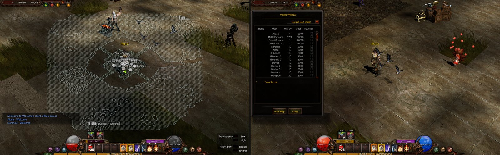</p>

### Effects and particles

Skill effects, joints (lightning), particles, sprites and the client's JSON effect system. Poison, Ice, Power
Wave, Meteorite, Aqua Beam and Inferno now draw their primary spell visuals. An audit of the 23 native cast
routes counts **18/23 primary visuals (56/77 weighted by exposure)**; Rageful Blow, buff/arrow/later-class
variants and live comparison remain ([skill visual coverage](docs/research/client-skill-visual-coverage.md)).

<p align="center">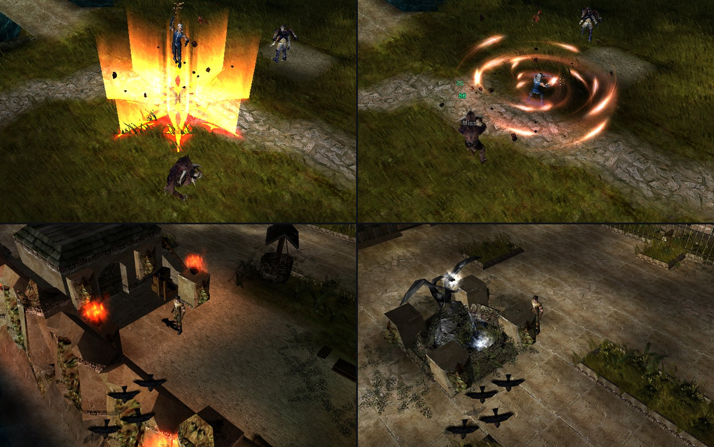</p>

### The interface: original GFx movies through Ruffle

The client's interface is Scaleform GFx (Flash). The native client converts the installed movies and runs them in a
[patched Ruffle](native/gfx/ruffle-patches) with the client's ActionScript extensions: the HUD, character window,
buffs, inventory, tooltips, shops, quest and skill windows. The HelpWindow loads the client's hotkey and chat help
rows into its real movie, opened with Ctrl+H. That key is a labelled native binding: the original open route is
not yet established ([help window](docs/handoffs/SYS-MISC-001b.md)).

| | |
|---|---|
| 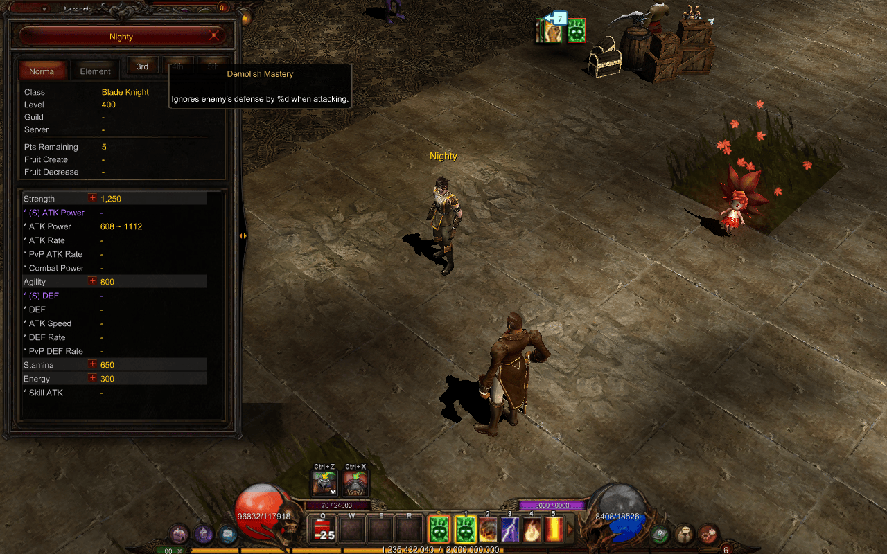 | 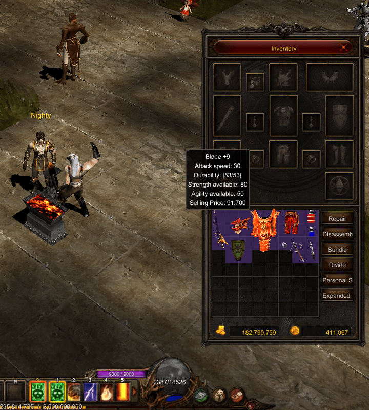 |
| Character window and buffs | Inventory, item models, tooltip and price |

### NPCs, shops and quests

Talking to NPCs (dialogue text from the client's tables), shops and the vault, and the client's quest system with
requirements and rewards. The loopback fixture now feeds quest state through the session. NPC quest-list
replies still need decoding, so that browsing path is unavailable
([session limits](docs/handoffs/SESSION-QUEST-001.md)).

<p align="center">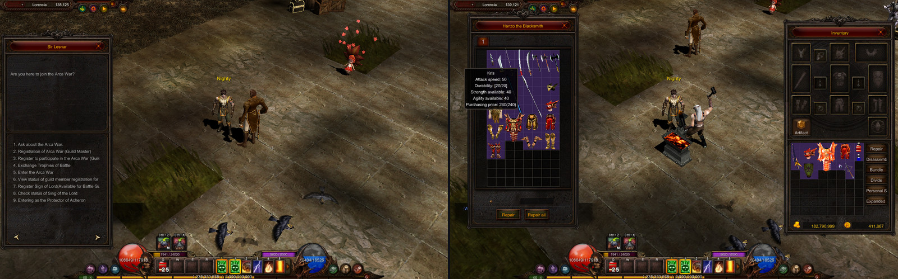</p>

The guide quests, class-upgrade quests and the quest tracker work as well: an NPC tells the story, My Quests lists
the steps with their requirements and rewards, and **Go Now** walks or travels to the next target, across worlds if
needed. The Shadow Phantom Soldier (NPC 257) stands in Lorencia in its +13 armour and wings, with its orbiting glow.

<p align="center">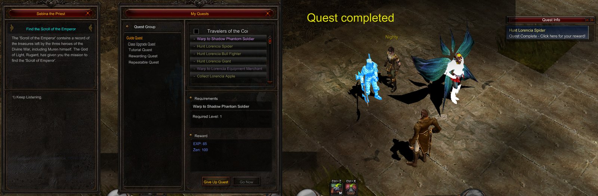</p>

### Skills, the Master tree and the fourth tree

The skill bar greys out what the character cannot use, tooltips show damage with the Master bonuses, and A opens
the Master skill tree with its icons, tooltips and learn requests. The Skill Imprint window sits where the client
puts it. Ctrl+A opens the fourth tree with its data, tooltips, icons and demo learn replies; its side stat panel
and some updates remain open. The fifth-tree windows can open, but their card/item behavior is unfinished
([fourth-tree evidence](docs/research/client-skills.md#12-the-fourth-tree-native-skill-003)).

| | |
|---|---|
| 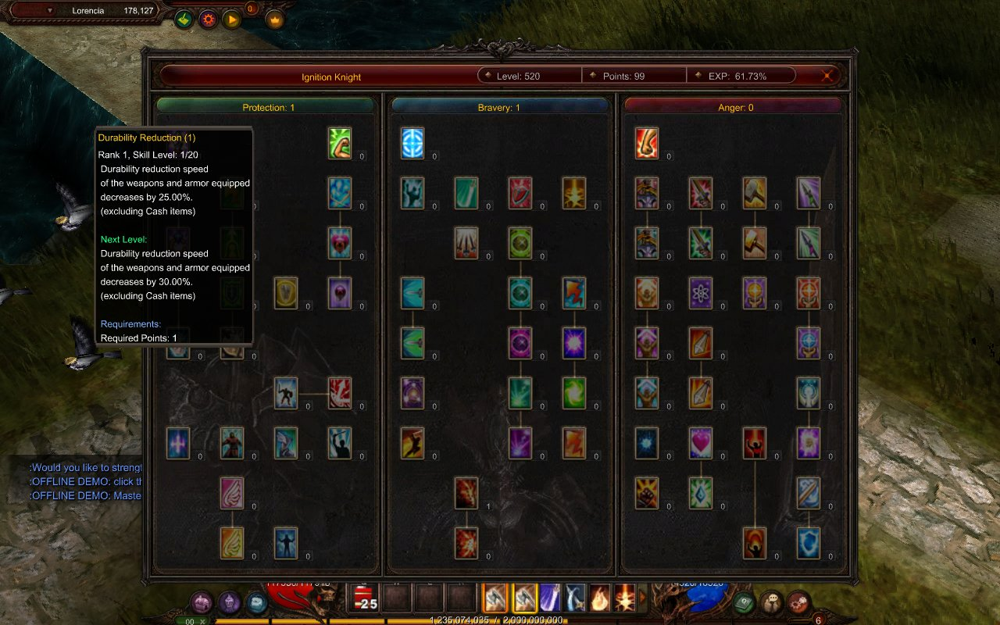 | 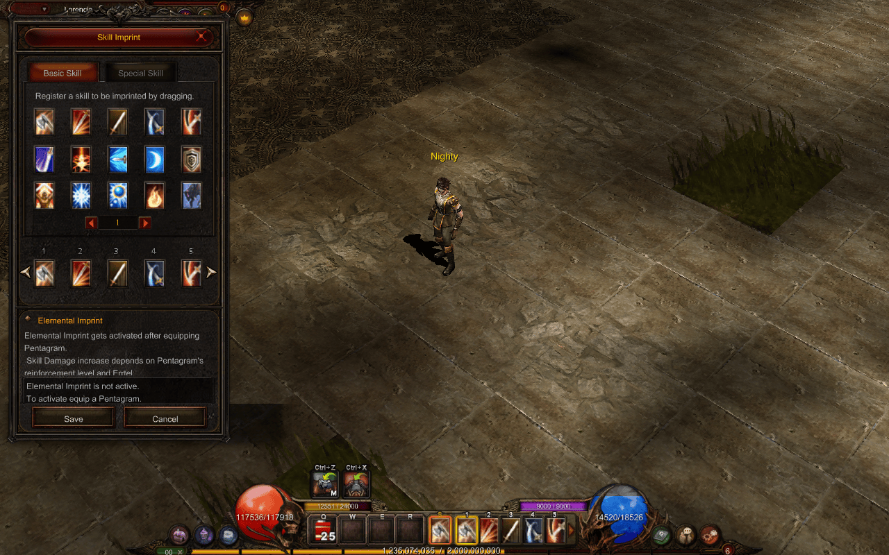 |
| The Master skill tree | The skill bar, tooltips and the Skill Imprint window |

<details>
<summary>The first quest window</summary>
<p align="center">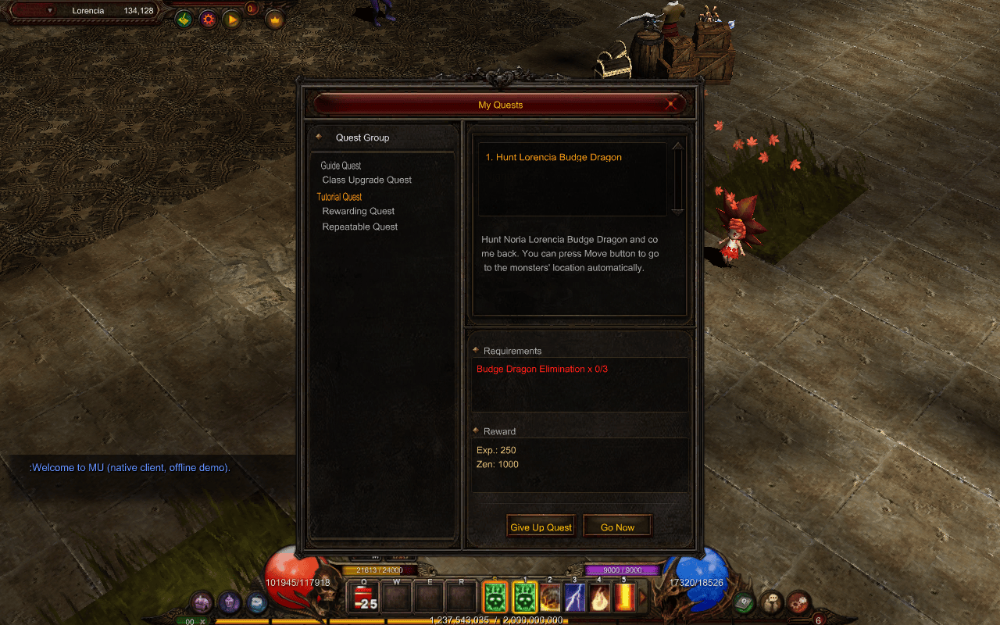</p>
</details>

### Combat, other players, pets and mounts

Attacks and skills with the client's damage text, hit and death handling, monster HP boxes and voices, dropped
items with labels and pick-up; other players with their equipment, wings and guild names; pets and mounts.

<p align="center">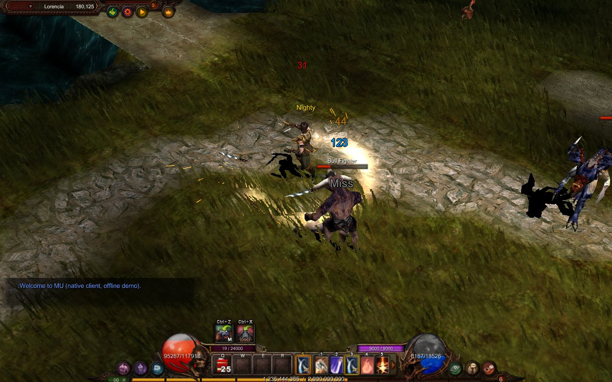</p>

<p align="center">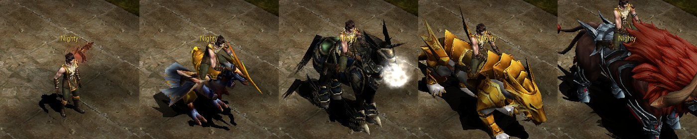</p>

The later mounts followed: 24 mount models with their moves and class effects (Shining Tail's sparkles, mist and
tail, Ghost Horse's aura and breath, Fenrir's lightning), the data-driven pets such as the Panda, Demon, Spirit of
Guardian and Rudolph, and the Dark Raven.

<p align="center">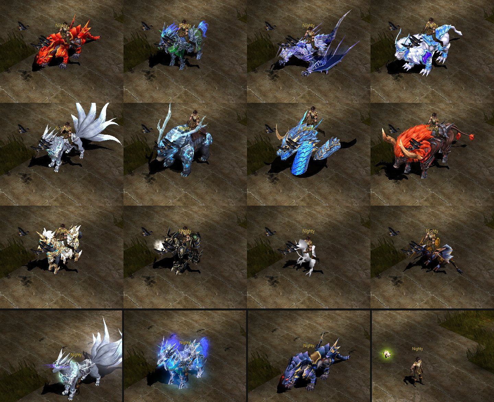</p>

### Item rendering

The shared renderer now covers **880/1,674 special item bodies and 17/17 class skins**, with linked sprites for
**17 targets / 22 item types** (weapons and shields) and skin sprites on ground items and in inventory. Recent
additions include rank-5 mesh streams, atlas armour and elemental seeds. These are bounded special draw
branches, not a count of every item the client can display. Ordinary models already use the common pipeline;
**794 special bodies**, full rank-5 owner effects and further links remain
([coverage and checks](docs/handoffs/RENDER-ITEMS-002J.md)).

### Item mixing, personal store and repair

The Chaos Goblin's mix window ranks the recipes, shows the success rate and cost, and takes jewels (Bless, Soul,
Life). The personal store registers and buys items, and NPCs repair. The outcome comes from the demo server, which
does not predict the real server's results.

<p align="center">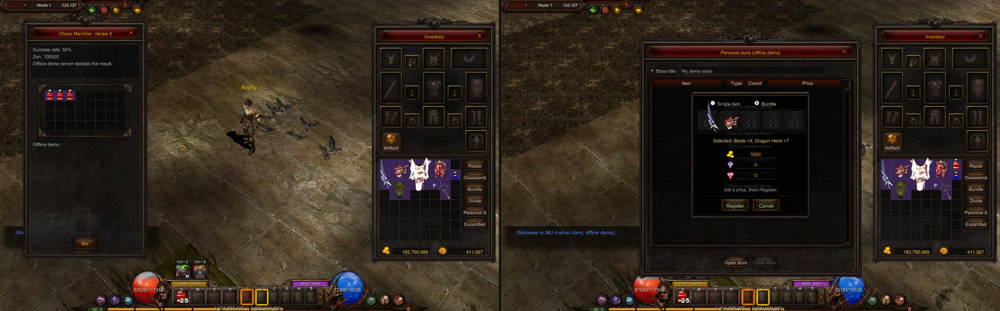</p>

### Party, trade, friends and mail

The party list and its markers, trade with full item details (excellent options from the client's tables), friends,
the messenger with whispers, and mail with read, reply, compose and delete. All of it runs on the client's own
handlers, with demo players standing in for real ones. Party membership and invitations now arrive through the
session; trade, friends and mail have not moved yet.

<p align="center">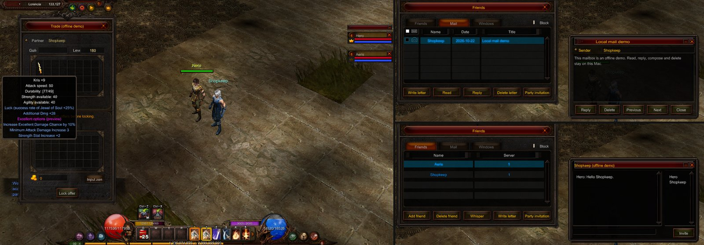</p>

### Experience, levels and options

Kills give experience; the bar fills, the level-up flares, and the character window's "+" buttons spend stat
points with the client's class formulas. O opens the Options window (saved in the client's format), Esc the system
menu (exit, select server, switch character), and a character that dies respawns in town.

<p align="center">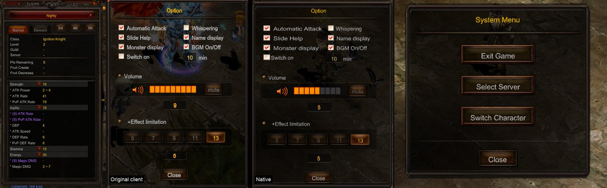</p>

### 80 players on screen

Eighty offline demo players in Lorencia and Tormenta Island, with varied classes, armour, weapons and wings.
The HUD and names use synthetic demo values.

<p align="center">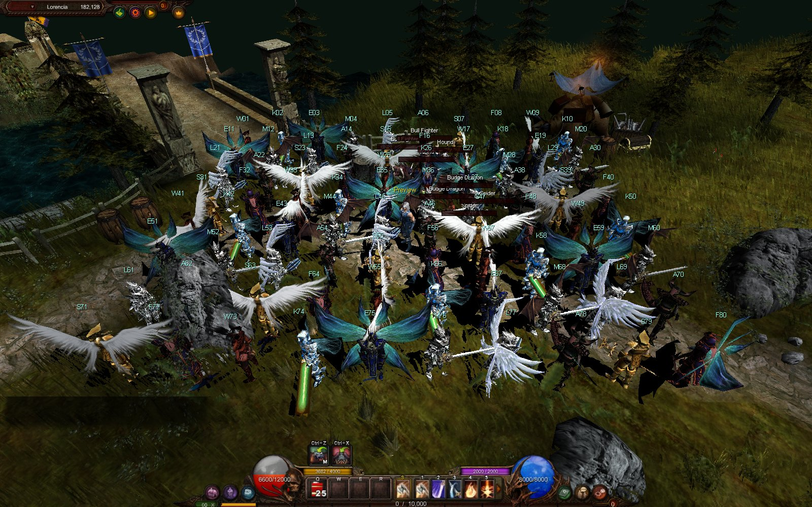</p>

<p align="center">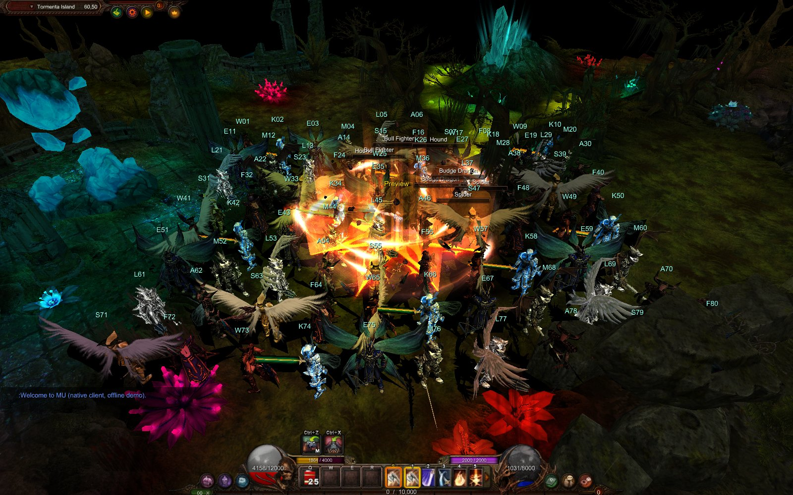</p>

For context, [NATIVE-PERF-003, PR #201](https://github.com/fryezero/mu-the-matrix-native/pull/201) measured
**crowd80 at 18.4 fps** and **tormenta80 at 18.9 fps** on this M5 Mac. **The 25 fps target remains open.**
Those measurements used the full-interface stress workload before this texture-loading correction. These
screenshots use spaced crowds, eight monsters and closed panels; their throughput was not measured
([capture details and checks](docs/research/readme-stress.md)). No later performance milestone has re-timed
these scenes, so those remain the current figures.

### Sound

World and event music, ambient sounds, footsteps and effects run through the native audio engine. Session cues
now carry walking, NPC/creature/object sounds and combat/skill sounds, including player and monster hurt/death
voices, the Master-tree click and ground drops; character select's Enter/Escape sounds use their own callback.
That makes **76 migrated sound sites**. Cue logs record the original sound site and session tick. Event/buff inputs, pick-up success sounds, other
unmigrated callers, two music entries and the original-client audio comparison remain open
([audio evidence](docs/research/client-audio.md)).

### Performance

Light offline scenes reach the client's own **25 FPS** (40 ms) frame cap with headroom,
including full screen: Lorencia needs about 14 ms of work per frame at the preview window size, and with the cap
removed the GL path renders 69 to 173 FPS at Retina full-screen size (3456 × 2160). See [native performance](docs/research/native-performance.md).

### Models

`mu-viewer` loads, animates and lights any of the client's BMD models (versions 10, 12, 14 and 15; 12,663 of
12,754 installed files parse).

<p align="center">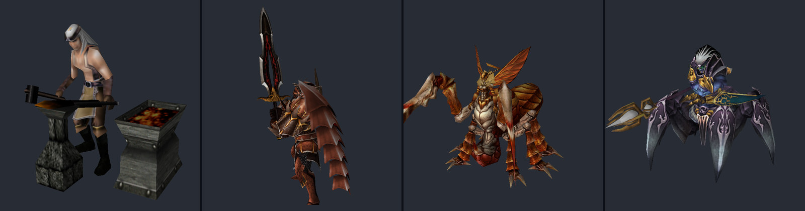</p>

## Progress

| Milestone | State |
|---|---|
| Client identity, unpacking boundary, code capture (QEMU x86 Linux/Wine guest) | Done |
| Formats: images, BMD models v10/12/14/15 (encrypted envelopes), terrain, effects JSON, data tables, `Lang.mpr` tables | Done |
| Model pipeline: decoder, bone tracks, pose builder, skinning, mesh draw | Done, verified in Unicorn |
| World: terrain, lighting, water/lava, objects, culling, environment, weather | Tested paths implemented; 33/144 primary handler methods across 11/48 classes, 111 methods open |
| Characters: assembly, gear, glow, monsters and NPCs | Offline rendering; players/monsters/NPCs now consume session records |
| Special item rendering | Partial; 880/1,674 bodies, 17/17 class skins, links for 17 targets / 22 types; 794 bodies remain |
| Movement: click-to-move, path finding, long-distance auto move, walk/run rules | Done, verified |
| Input: one router and shared scripts across world/client tools | Implemented; 570 instruction cases, 0 mismatches, 7/7 planted mistakes caught; unavailable panels listed separately |
| Scenes: title, login world, server select, character select and creation, loading | Offline; shared character-select runtime, unchanged render comparisons; account session still open |
| Interface: 2D layer, legacy windows, GFx movies via Ruffle, HUD, inventory, tooltips, names, chat bubbles | Done |
| Help window: help rows, controller, real movie | Implemented offline; 888 instruction cases, 0 mismatches, 18/18 planted mistakes caught; Ctrl+H is a native binding |
| Gameplay systems: combat, items, NPC talk/shops/vault, quests, skills, players, pets and mounts | Offline implementations with domain-specific limits; session migrations continue |
| Session: hero, quests, players, monsters/NPCs, combat, skills, ground items, minimap markers, party | Local plaintext fixture feeds; 11/11 scenarios, 86 inbound frames, 0 unbound/undecodable in those scenarios |
| Maps and travel: Tab map with NPC markers, Move window, gates, world changes | Done offline; 5,001 Unicorn cases, 0 mismatches |
| Skills 2: skill state, usability, Master tree, Imprint position | Done offline; 12,384 cases, 0 mismatches |
| Pets and mounts 2: 24 mounts, class effects, pets, Dark Raven | Done; 8,400 mount and over 21,000 effect cases, 0 mismatches |
| Quests 2: guide and class-upgrade quests, tracker, Go Now, NPC 257 | Done offline; 7,004 + 7,400 cases, 0 mismatches |
| Item mixing, jewels, personal store, repair | Client side done; 98,506 comparisons, 0 mismatches |
| Social: party, trade, friends, messenger, whispers, mail | Client side done; 36,700 comparisons, 0 mismatches |
| Progression: experience, levels, stat points, Options window, system menu, respawn | Done offline; 18,506 cases, 0 mismatches |
| World fidelity: original vs native tour of 13 maps, clouds/dragons, flames, object details and screen haze | Named fixes implemented; Icarus image error 26.897 → 23.154; fresh synchronized live comparisons remain open |
| Temporal fidelity: scripted camera paths, multi-frame samples, thresholds | Native half implemented as a regression gate; original-client capture half open |
| Skill visuals: primary spell effects on the 23 native cast routes | 18/23 primary (56/77 weighted); Rageful Blow and later variants open |
| Later skills: fourth and fifth trees | Fourth tree implemented offline, 6,510 instruction cases, 0 mismatches; fifth-tree card/item behavior remains open |
| Audio: music, ambient, footsteps, effects | Event music and 76 sound sites on session cues; remaining callers/inputs and live audio parity open |
| Packaging: `Mu The Matrix Native Preview.app`, 25 FPS frame cap, resizable window, full screen | Done; Preview rebuilt and smoke-tested on October 28 (PR #215) |
| First run and Native Data | Bundled C converter needs no Python; build-keyed manifests verify inputs/outputs and refuse incompatible sets; second-user acquisition remains open |
| Private integration | 38/38 private-enabled test directories green at PR #200; 1,464 unique tests passed, 15 optional Ruffle/movie skips ([record](docs/handoffs/INTEGRATION-GREEN-001.md)) |
| Crowded-scene performance | NATIVE-PERF-003 measured crowd80 18.4 fps / tormenta80 18.9 fps; 25 fps target open |
| Network: framing, transport and CryptoModule | Implemented components; encrypted decode/send, recovered routing and account integration remain open |
| Live login and end-to-end gameplay against the real servers | Not available; remaining network/live lanes are left to the owner ([plan](docs/design/native-port/plan.md)) |

Instruction-case counts compare authored C against the client's own instructions in Unicorn, with planted
mistakes to prove the check can fail. Fixture frames and integration tests are separate checks; their counts do
not claim original-instruction or live-game parity. The full per-milestone record is in [docs/status.md](docs/status.md) and
[docs/roadmap.md](docs/roadmap.md).

### What is still missing

- **Online play.** The preview remains offline. Framing, transport, the CryptoModule and migrated session
  domains exist, but encrypted decode/send, recovered routing, account/login and live acceptance remain. Those
  network/live lanes are left to the owner. Fixtures supply synthetic replies, not the real server's rules.
- **Skills and quests.** Fifth-tree card/item behavior, fourth-tree side stats, FormulaData and authoritative
  equipment/buff/event inputs remain open. NPC quest-list replies still need decoding; encrypted requests stay
  unsent ([quest limits](docs/handoffs/SESSION-QUEST-001.md), [skill limits](docs/handoffs/SESSION-SKILL-001.md)).
- **Rendering and live comparisons.** There are 111 primary world-handler methods and 794 special item bodies
  left, plus rank-5 owner effects, further links, five primary skill visuals and other effects. The named
  cloud/flame/haze fixes do not establish complete map fidelity. The native temporal gate exists, but the original-client capture with matched clocks, RNG and
  effect pools is still missing for synchronized comparisons.
- **Performance.** The full-interface 80-player workload still falls below 25 fps; frame-pacing tails remain open.
- **Items, social and helpers.** Jewel settlement, harmony options, the separate Chaos weapon system, Muun pets,
  rare transformed-class effects and inventory-driven helper selection remain. Pick-up answers, inventory
  insertion and zen credit are not migrated; trade, friends and mail still use demo replies.
- **Installation for other users.** Python-free first run and build-keyed data checks work in temporary-home tests.
  Guided capture and a real second-user install/restart/upgrade proof remain open; distribution signing is deferred.

## Architecture

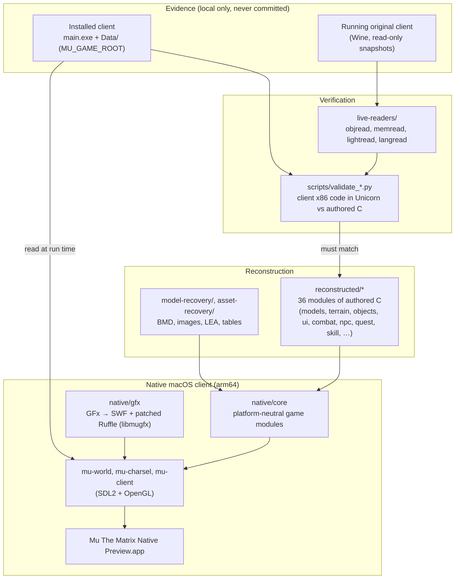

## Build and run

You need an Apple-silicon Mac with the Xcode Command Line Tools, Homebrew and Python 3. **You must supply your own
installed Mu The Matrix client** (`MU_GAME_ROOT`, the folder with `main.exe` and `Data/`): this repository contains
no game files. The [Mac app](https://github.com/fryezero/mu-the-matrix-mac) installs one at
`~/Library/Application Support/MuTheMatrix/prefix/drive_c/MuTheMatrix`.

```sh
brew install cryptopp sdl2 jpeg-turbo
git clone https://github.com/fryezero/mu-the-matrix-native.git && cd mu-the-matrix-native
python3 -m venv tools/.venv && tools/.venv/bin/pip install -r tools/requirements-portable.txt
make test PYTHON=tools/.venv/bin/python          # builds native tools and runs tests (private checks skip)
make -C native client                            # native/build/mu-client (and mu-world, mu-charsel)

export MU_GAME_ROOT="$HOME/Library/Application Support/MuTheMatrix/prefix/drive_c/MuTheMatrix"
native/build/mu-client --game-root "$MU_GAME_ROOT" --session native/client/demo-session.txt   # the offline client
native/build/mu-world  --game-root "$MU_GAME_ROOT"                                            # straight into a world
native/build/mu-viewer "$MU_GAME_ROOT/Data/Monster/Monster01.bmd"                             # one model
```

For the GFx interface, fetch and build Ruffle first (`native/gfx/fetch-ruffle.sh && native/gfx/build-mugfx.sh`).
The double-clickable **Native Preview app** bundles all of it with a first-run data setup and a network guard.
First run uses a bundled C converter, so the built app needs no Python/Pillow. Build-keyed Native Data manifests
record source/output hashes and reject incompatible or incomplete sets
([setup and re-acquisition](docs/native-data.md)):

```sh
make -C native preview-app        # native/build/app/Mu The Matrix Native Preview.app
make -C native/app install        # copy to ~/Applications
```

Every tool and option is documented in [native/README.md](native/README.md). Private integration checks against
your installation run with `MU_RECOVERY_INTEGRATION=1 make test` ([setup](docs/setup.md)). The merge gate is
`bash scripts/local-macos-ci.sh` on a Mac; there is no hosted CI.

## Repository layout

```text
native/            The native client: core modules, mu-world/mu-charsel/mu-client, viewer, GFx (Ruffle), preview app, tests
reconstructed/     Authored C reconstructions of client routines, one module per subsystem, with tests
scripts/           Unicorn validators (validate_*.py), static analysis, loader recovery, publication audit, local CI
live-readers/      Read-only snapshot tools for the running original client (macOS host tools)
model-recovery/    BMD geometry, bones, animation and encrypted envelopes (v10/12/14/15)
asset-recovery/    Image wrappers and text-mesh readers
runtime-linux/     QEMU x86 Linux/Wine guest procedure for code capture (historical, unmaintained)
windows-capture/   Read-only Windows capture helper (not yet validated on Windows)
docs/              Status, roadmap, handoff, architecture, research notes, images
tests/             Repository-level tests (publication boundary, static maps, private checks)
```

## Scope and legal

- **No game data here.** The repository contains authored source, synthetic test fixtures and written findings.
  It never contains the client executable, DLLs, game assets, decoded models or textures, text tables, process
  dumps or memory snapshots; `scripts/audit_repository.py` enforces this on every change. The README images are
  screenshots and renders made for documentation, reviewed and hash-pinned. You need your own installed client
  to build anything that shows the game.
- **Out of scope.** The client's protection and licensing modules (the packer, IGC.dll, RGS.dll, "Hash
  Protection") are treated as opaque and are not analysed. Current native builds run offline against local
  demo answers and block outside connections. The live login is the planned end state and goes through an operator
  contract, never through the launcher's or IGC's protected handshake.
- **Ownership.** Mu The Matrix, its client, assets and servers belong to their owners; this project is done with
  the server owner's authorization. The MIT license ([LICENSE](LICENSE)) covers this project's own code and
  documentation only, not the game, its assets or anything derived from them. Third-party components (SDL2,
  libjpeg-turbo, Crypto++, Ruffle, Unicorn, Capstone) keep their own licenses:
  [THIRD_PARTY_NOTICES.md](THIRD_PARTY_NOTICES.md).

## Related

- [**mu-the-matrix-mac**](https://github.com/fryezero/mu-the-matrix-mac): play the original client on a Mac today
  (free app, Wine runtime, 25 FPS). It was part of this repository until October 2026; its history moved with it.
- Contributing: [CONTRIBUTING.md](CONTRIBUTING.md), [AGENTS.md](AGENTS.md), [docs/handoff.md](docs/handoff.md).

## Target identity

- `main.exe`: PE32 x86 Windows GUI, 32,229,376 bytes, embedded version `1.20.87.0`.
- SHA-256 `3cf91f3c203d305a771b04d00b271871f7ce1c6779b22e30fbae8c4f35b5527a`; entry VA `0x0e646058`; image base `0x00400000`.
