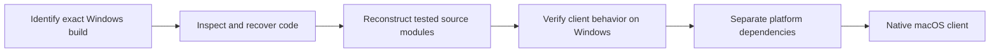

# Mu The Matrix recovery

Understand the exact Mu The Matrix Windows client, reconstruct tested source modules, and eventually make the game playable natively on macOS.

**Current phase: reverse engineering and source reconstruction. A playable source rebuild and native macOS client do not exist yet.** The original client works on the owner's Windows system and fails in CrossOver on the Mac used for this investigation.

This repository gives humans and agents a common starting point: original recovery code, reproducible checks, evidence summaries, and a work queue. [REA](https://github.com/morluto/rea) with Ghidra supports native analysis; format readers and reconstructed modules are implemented here.

## Start here

| You want to… | Read |
|---|---|
| Continue with an agent | [AGENTS.md](AGENTS.md), then [handoff](docs/handoff.md) |
| See what actually works | [Current status](docs/status.md) |
| Build and run checks | [Setup](docs/setup.md) |
| Choose a contribution | [Roadmap](docs/roadmap.md) and [contributing](CONTRIBUTING.md) |
| Understand the code boundaries | [Architecture](docs/architecture.md) |
| Recover executable code | [Code recovery](docs/code-recovery.md), [Mac-only runtime](runtime-linux/README.md), [Windows helper](windows-capture/README.md) |
| Work on assets | [Images](docs/asset-recovery.md), [models](docs/model-recovery.md), [primary sources](model-recovery/SOURCES.md) |

## Verified progress

These are structural and component-level results for one pinned installation. They do not establish equivalent gameplay or rendering.

| Component | Verified result | Remaining gap |
|---|---|---|
| Startup decompressor | Portable C builds; four original blocks match independent decoding byte for byte | Recovered 41,984,000-byte region is still protector material |
| Native inspection | REA/Ghidra decompile a restored client arithmetic routine from a verified prefix | Full function map, calling conventions and behavior still need recovery |
| Mac-only runtime | QEMU x86 Linux/Wine restores a repeatable 23,572,480-byte client-code mapping | No demonstrated login/gameplay; compatibility-environment limits remain |
| Images | 19,703 / 19,707 wrapper candidates decode; selected PNG exports match pixels | Three terrain images rejected; one candidate is actually mesh text |
| BMD models | 12,663 / 12,754 files parse; versions 10, 12, 14 and 15 supported | 17 rejected; 74 other/table files unsupported |
| Effect descriptions | 370 JSON files parse; all 92 distinct texture references resolve locally | Original engine interpretation of their fields remains open |
| Windows capture helper | Builds as a Windows x64 console program; hash and own-memory smoke tests pass under Wine | Actual game capture on Windows has not been validated |

The latest original-file scan and all binary evidence stay local. [The evidence index](docs/evidence-index.json) preserves artifact identities, coverage, and relative locations without bundling game material.

## Build the recovery modules

Python 3.9+, Clang/Clang++ and Crypto++ are required. The portable build targets macOS and Linux. Pillow supports image-reader tests; Crypto++ supplies the eight v14 block ciphers.

```sh
# macOS; on Debian/Ubuntu install libcrypto++-dev instead
brew install cryptopp
python3 -m venv tools/python
./tools/python/bin/python -m pip install -r asset-recovery/requirements.txt
make test PYTHON=./tools/python/bin/python
```

The default suite uses authored fixtures and public LEA test vectors. Four checks requiring the original installation/evidence are explicitly skipped. To run those checks, follow [private integration setup](docs/setup.md#private-integration-checks).

```sh
# Optional Windows helper cross-build with MinGW-w64
make windows
```

## Project map

```text
asset-recovery/        Image wrappers and editable text-mesh readers
model-recovery/        BMD geometry, bones, animation and encrypted envelopes
reconstructed/boot/   Tested C startup decompressor
windows-capture/      Read-only Windows executable-region capture source
runtime-linux/        Mac-only x86/Wine procedure and scoped text capture
scripts/              PE inventory, REA collection, loader recovery and emulation
model-recovery/fixtures/  Public cryptographic vectors, no game data
docs/                 Findings, architecture, roadmap and agent handoff
.github/              CI and contribution templates
```

`input/`, `evidence/`, `runtime/`, `vendor/` and recovered asset outputs are local-only and ignored. Supply your own matching installation; no game executable, asset pack, process dump or recovered game payload is distributed here.

## Direction



The immediate dependency is faithful runtime evidence. No Windows PC is available, so a [full x86 Linux/Wine experiment on the Mac](docs/research/mac-runtime.md) now restores readable client code. The Mac startup attempts hit `rosetta error: invalid gdt selector index 6`; that is a recorded environment failure, not evidence of a completed port. Selecting a macOS graphics framework or redesigning gameplay comes after code and behavior are understood. An older MU client is not a substitute for this exact-version target.

## Target identity

- Format: PE32, x86 Windows GUI, 32,229,376 bytes.
- Embedded version label: `1.20.87.0`, not independently verified release provenance.
- `main.exe` SHA-256: `3cf91f3c203d305a771b04d00b271871f7ce1c6779b22e30fbae8c4f35b5527a`.
- Entry VA: `0x0e646058`; image base: `0x00400000`.

## License

Original code and documentation in this repository are MIT licensed; see [LICENSE](LICENSE). The license covers this project's implementations, not the supplied game, its assets, decompiled output, or external tools. Source references and their distinct licenses are listed in [third-party notices](THIRD_PARTY_NOTICES.md).
